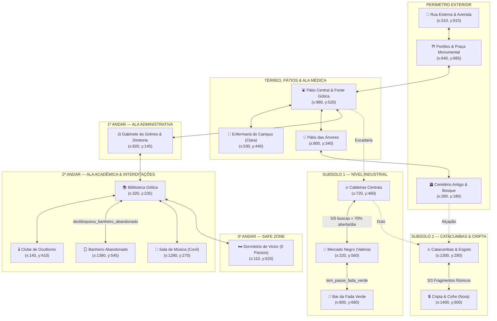

# 🏰 GUIA ARQUITETÔNICO & DOSSIÊ CARTOGRÁFICO: ACADEMIA SÃO CIPRIANO
### Dossiê Técnico e Cartográfico do Mapa Tático (17 Setores — Live Build Novembro 2026)
**Projeto:** *The Hunger and the Hallways*  
**Resolução Padrão de Tela:** `1920 x 1080` (Widescreen 16:9)  
**Estilo Artístico:** *Dark Gothic Victorian Cartography / Antique Alchemical Blueprint / Stained Parchment & Gold-Embossed Noir*

---

## 🧭 1. VISÃO GERAL & AS DUAS PLANTAS DO MAPA (`mapa_tatico_escola`)

O mapa da Academia São Cipriano possui **17 setores interativos** (`11 na Superfície + 6 no Subsolo & Exterior`) sobre fundos diurno, vespertino e noturno (`mapa manha`, `mapa tarde`, `mapa noite`), com overlay climático frio (`#0b192844`) durante o clima `chuva_vitrais` nos turnos diurnos.

1. **Aba 1: 🏛️ SUPERFÍCIE (11 Setores):** Fachada monumental, pátios abertos, ala médica (**Enfermaria**), 1º/2º andares acadêmicos e ala residencial dos bolsistas (**Dormitório — Zona Segura 0 Passos**). *(Nota técnica: o cabeçalho em `custom_screens.rpy:3263` ainda exibe o texto legado `"10 SETORES"`, embora renderize todos os 11 pinos).*
2. **Aba 2: 🕳️ SUBSOLO & EXTERIOR (6 Setores):** Complexo das caldeiras, Mercado Negro clandestino com trava diária, Bar da Fada Verde, necrópole externa, Catacumbas rotativas e a Cripta de Nora.

### Sistema de Zonas de Tensão & Custos de Deslocamento
* 🔵 **Zona Azul (Manhã / Refúgio):** Baixo risco letal; **Dormitório** permanece Zona Segura inviolável (`0` passos de investigação e `0%` de risco mesmo sob toque de recolher).
* 🟡 **Zona Amarela (Tarde / Vigilância):** Patrulhas disciplinares, coleta da Campanha de Saúde e negociações.
* 🔴 **Zona Vermelha (Noite / Subsolo Profundo):** Emboscadas da tabela de **26 arquétipos** (`sorteio_mob`), anomalias WOH e drenagens furtivas.
* **Limites por Turno:** `3` passos (`investigar_passo_bs`) e `3` visitas (`2` se o estado `paranoia_executor` estiver ativo). Visitar `dormitorio` nunca consome passos.

---

## 🗺️ 2. MAPA ESPACIAL, TRAVAS METROIDVANIA & CONEXÕES



---

## 🏛️ 3. PLANTA I: SUPERFÍCIE (11 SETORES COM COORDENADAS EXATAS)

### 1. 🛏️ Dormitório de Victor (`dormitorio`) — `xpos 110, ypos 620`
* **Tensão:** 🔵 **Zona Segura Permanente (0 Passos)**. `investigar_passo_bs` bloqueia gasto de passos no quarto e não há emboscadas.
* **Mecânicas Exclusivas:**
  - `acao_descansar_dormitorio`: Recupera `45 / 30 / 15 / 5 HP` conforme passos restantes, cura sequelas (`100%` com 3 passos, `70%` com 2), limpa `rastro_olfativo` e protege contra toque de recolher (`-10 HP` em pesadelo se `fome < 25`).
  - **Sinergias de Vigília:** Emília + Lility juntas, Emília sozinha ou Lility sozinha concedem bônus adicionais de Humanidade/Saciedade/Afeto ao dormir.
  - **Encontros sem Passo:** `menu_encontro_emilia_dormitorio`, `menu_encontro_lility_dormitorio` e o confronto simultâneo **`evento_embate_dormitorio_lility_emilia`** quando ambas estão presentes (`loc_emilia == "dormitorio"` e `loc_mestra == "dormitorio"`).
* **Fundos Animados / Som:** `bg animado dormitorio quarto {manha raio sol | dia computador | tarde sol | noite luar | chuva}` • Canal `ambient`: `amb_bg_animado_dormitorio_quarto_*.ogg`.

### 2. ⚖️ Gabinete do Grêmio & Diretoria (`salao_gremio`) — `xpos 820, ypos 145`
* **Tensão:** 🟡 Zona Amarela (Poder Político).
* **Drops & Ações:** Reduzir Exposição (`-15%`), entrega de Relatórios (`$120` ou `$240` sob Inspeção), audiência com **Elara**, **Caso 5: Os Arquivos Mortos**.
* **Fundos / Som:** `bg animado gabinete diretor {dia cortinas | entardecer sol | por do sol | noite candelabro | noite lampada | chuva}` • `ambient = None` de dia/tarde (prioriza `The_Cold_Decree.ogg`), candelabro à noite.

### 3. 📚 Biblioteca Gótica & Galeria dos Esquecidos (`biblioteca`) — `xpos 320, ypos 235`
* **Tensão:** 🔵 Azul de dia / 🔴 Vermelha à noite.
* **Drops & Ações:** `Giz de Proteção`, `+1 Conhecimento Oculto`, **Caso 4: A Partitura Carnal**, pesquisa genealógica com **Emília** (`ev_c16_investigacao_genealogica_lyra`).
* **Fundos / Som:** `bg animado biblioteca gotica mesas {manha | noite | chuva}` • `ambient = None` (`The_Unfinished_Lesson.ogg`).

### 4. 🎹 Sala de Música Interditada (`sala_musica`) — `xpos 1280, ypos 270`
* **Tensão:** 🔴 Covil Vampírico de **Lility**.
* **Drops & Ações:** **Covil de Alimentação (`menu_alimentacao_covil_lility`)** com 5 modalidades (máx. 1x por período e bloqueado se `fome >= 85%`), **Caso 4: Partitura Carnal**, toque sensorial / dormir de manhã (`evento_rng_lility_dormindo_manha`).
* **Fundos / Som:** `bg animado sala musica piano {vitral sol | noite | vitral chuva}` • `ambient = None` durante diálogo/piano.

### 5. 🌳 Pátio das Árvores Centenárias (`patio_arvore`) — `xpos 800, ypos 340`
* **Tensão:** 🟡 Amarela de dia / 🔴 Vermelha à noite.
* **Drops & Ações:** 45% Giz, 30% `$40–$100`, 25% Kit Médico, **Caso 2: Hachishaku-sama**.
* **Fundos:** `bg animado patio arvore {dia claro | entardecer folhas | postes noite | chuva}`.

### 6. 🕯️ Clube de Ocultismo & Alquimia (`sala_ocultismo`) — `xpos 140, ypos 410`
* **Tensão:** 🟡 Amarela.
* **Drops & Ações:** Giz (`60%`) / Conhecimento Oculto (`40%`), **Caso 5: Os Arquivos Mortos**, palco do **Pacto de Sangue de Emília** (`evento_emilia_pacto_sangue`).
* **Fundos:** `bg animado sala aula ocultismo alquimia verde` / `bg clube_ocultismo_noite`.

### 7. 🏥 Enfermaria do Campus (`enfermaria`) — `xpos 530, ypos 440` *(11º Setor Oficial)*
* **Tensão:** 🟡 Amarela / 🔵 Triagem Clínica (**Dra. Clara Vance**).
* **Ações (`acao_consultar_enfermaria`):**
  - Compra de Bolsa Filtrada (`$100`) e Kit de Curativos (`$50`).
  - Tratamento de Sequela (`$80` -> cura sequela + `+20 HP`).
  - Venda de Hemograma Rh-Nulo (`+$120`, `+10% Exposição`, 1x/dia).
  - **Drenagem Furtiva (Banquete Clínico):** Se `fome < 70` e 1x/dia -> `+30%` Saciedade, `+20 HP`, `+1 Int`, `+10%` Exp, `+3%` DOOM (`-5 Hum` em código) e hipnose de Clara.
  - Eventos conectados: `ev_rastro_oculto_nora_enfermaria`, `ev_c02_triagem_enfermaria` e `ev_c19_laudo_sincope_clara`.

### 8. ⛲ Pátio Central & Fonte Gótica (`patio_fonte`) — `xpos 980, ypos 520`
* **Tensão:** 🟡 Amarela / 🔴 Vigília de Executores à noite (`ev_c18_vigilia_executores_sombra`).
* **Drops & Ações:** Rumores estudantis, figurantes de uniforme preto (`encontro_mob_figurante`), predação de Campanha de Sangue, `$50–$120` / Giz.
* **Fundos:** `bg animado patio claustro fonte {dia | entardecer | noite | chuva}` e `arcos`.

### 9. 🪞 Banheiro Abandonado do 2º Andar (`banheiro_abandonado`) — `xpos 1380, ypos 545`
* **Trava Metroidvania (`desbloqueou_banheiro_abandonado`):** Exige conversar com Emília sobre desaparecimentos ou ouvir rumores.
* **Drops & Ações:** **Caso 1: A Loira do Banheiro** (3 pistas no espelho trincado -> duelo no espelho -> `-12%` DOOM em código), Giz Rúnico.
* **Fundo:** `bg animado banheiro abandonado luz vermelha piscando`.

### 10. ⛩️ Portões & Praça Monumental (`portoes_praca`) — `xpos 640, ypos 685`
* **Tensão:** 🟡 Amarela / 🔴 Vermelha à noite (Fronteira física do Grilhão de Sangue).
* **Drops & Ações:** Suborno policial (`-20%` Exposição), **Caso 2: Hachishaku-sama**, `ev_lility_fronteira_portoes`.
* **Fundos:** `bg animado entrada academia portoes {manha | entardecer sol | nevoeiro noite | chuva}`.

### 11. 🚗 Rua Externa & Avenida do Campus (`rua_portao`) — `xpos 310, ypos 815`
* **Tensão:** 🟡 Amarela.
* **Drops & Ações:** 40% Sucata, 30% `$60–$130`, 15% Absinto, 15% Kit Médico; rondas policiais.
* **Fundos:** `bg animado rua portao academia {manha | tarde | noite}` / `bg animado rua avenida campus chuva`.

---

## 🕳️ 4. PLANTA II: SUBSOLO & EXTERIOR OCULTO (6 SETORES COM COORDENADAS EXATAS)

### 12. 🪦 Cemitério Antigo & Bosque da Névoa (`cemiterio_nevoa`) — `xpos 280, ypos 180`
* **Drops & Ações:** **Caso 2: Mulher de Oito Pés**, `$60–$140` (30%), Kit (25%), Giz (20%), Sangue Adulterado (25%); Mausoléu von Karsten.
* **Fundo:** `bg cemiterio nevoeiro postes noite` / `bg animado cemiterio chuva`.

### 13. 🛒 Mercado Negro das Caldeiras (`caldeiras`) — `xpos 220, ypos 560`
* **Travas:**
  1. `desbloqueou_mercado_negro`: requer **5/5 investigações** nas Caldeiras Centrais (ou Dia 10 Noite).
  2. `mercado_negro_aberto_hoje`: **30% de chance diária de fechamento** contra rondas (exceto rede de segurança no Dia 10 Noite).
* **Drops & Ações:** Loja de **Valéria** (`menu_loja_valeria_loop`), compra **`Fiado`**, `bancada_crafting` (4 receitas), `evento_valeria_safra_rara`.
* **Fundo / Som:** `bg animado caldeiras esconderijo tocha azul e fogo` • `amb_bg_animado_caldeiras_esconderijo_tocha_azul_e_fogo.ogg`.

### 14. 🔥 Caldeiras Centrais da Academia (`sala_caldeiras`) — `xpos 720, ypos 460`
* **Rotação Antirrepetição (`sortear_bg_caldeiras()`):** Alterna sem repetir entre `bg animado corredor industrial subsolo vapor`, `bg animado corredor industrial caldeira subsolo vapor` e `bg animado caldeiras oficina fornalha brasa`.
* **Áudio / Drops:** `Iron_Lungs.ogg`, progresso `1..5/5` do Mercado Negro, 35% Sucata, 25% `$40–$90`, 20% Absinto, 20% Sangue Adulterado, **Caso 3: Lote Necrótico**, `ev_c17_inundacao_agua_negra`.

### 15. 🧚 Bar da Fada Verde (`bar_fada_verde`) — `xpos 800, ypos 680`
* **Trava:** `tem_passe_fada_verde` (`$260` base com confiança de Valéria, ou Dia 10 Noite).
* **Drops & Ações:** Doses de Absinto, Sangue Adulterado/Sucata/Dinheiro, confrontos e segredos da Fada Verde, `marco_40_fada_verde`.
* **Fundos:** `bg animado bar grunge luzes neon` / `bg animado bar grunge taverna fogo verde`.

### 16. ⚔️ Catacumbas & Esgoto Colonial (`catacumbas`) — `xpos 1300, ypos 280`
* **Rotação Antirrepetição (`sortear_bg_catacumbas()`):** Alterna sem repetir entre `bg animado catacumbas corredor tochas`, `bg animado catacumbas corredor runas tochas` e `bg animado catacumbas cofre velas verdes`.
* **Regra Especial:** Zona letal contínua com chance de **60%** de desenterrar os **3 Fragmentos Rúnicos da Chave da Cripta** (`fragmentos_chave_cripta` 1/3 -> 3/3) além de espólios de sangue adulterado, giz e moedas.

### 17. 🔒 Cripta Ancestral & Cela de Nora (`cripta_cofre`) — `xpos 1400, ypos 600`
* **Trava (`desbloqueou_cripta_cofre`):** Requer `3/3` Fragmentos Rúnicos das Catacumbas.
* **Conteúdo:** Cela de contenção de **Nora (Cobaia #31)**, Cofre dos Fundadores, relíquias ancestrais e interseção com o clímax subterrâneo.
* **Fundos:** `bg animado cripta cela vidro runas fechada` / `bg animado cripta cela vidro quebrada runas piscando` / `bg cripta antecamara portao runas altar 2k`.

---

## 🎨 5. DIAGRAMA DE COMPOSIÇÃO PARA UI E ARTES (`1920x1080`)

```text
+---------------------------------------------------------------------------------------------+
| [TOP HUD BAR]: Dia/Turno | Zona | Visitas/Passos | HP | Sede | Hum | Exp | $ | DOOM | Abas  |
+---------------------------------------------------------------------------------------------+
|                              (820, 145)                                                     |
|      (320, 235)             [⚖️ Grêmio]                      (1280, 270)                    |
|     [📚 Biblioteca]                                        [🎹 Sala Música]                 |
|                            (800, 340)                                                       |
|   (140, 410)              [🌳 Pátio Árvores]                                                |
|  [🕯️ Ocultismo]     (530, 440)           (980, 520)         (1380, 545)                     |
|                   [🏥 Enfermaria]      [⛲ Pátio Fonte]     [🪞 Banheiro]                   |
|   (110, 620)                      (640, 685)                                                |
|  [🛏️ Dormitório]                [⛩️ Portões]                                                |
|          (310, 815)                                                                         |
|         [🚗 Rua Externa]                                                                    |
+---------------------------------------------------------------------------------------------+
| [BOTTOM DOCK]: Info do Setor em Hover | [🛏️ Ir ao Quarto] | [⏳ Encerrar Período]          |
+---------------------------------------------------------------------------------------------+
```
*(No Subsolo/Exterior, os 6 pinos ocupam: Cemitério `(280, 180)`, Mercado Negro `(220, 560)`, Caldeiras `(720, 460)`, Fada Verde `(800, 680)`, Catacumbas `(1300, 280)` e Cripta `(1400, 600)`).*

---

## 🗝️ 6. APOSENTOS PRIVADOS & MISSÕES DE INFILTRAÇÃO (GOTHIC SUSPENSE)

Os quartos das protagonistas não são setores de livre circulação com pinos abertos no mapa tático (para evitar quebra de fronteiras narrativas e risco de exploração trivial), mas **espaços de missão e eventos específicos de infiltração furtiva**:

1. **Aposentos Privados da Presidente Elara (Ala Nobre do Grêmio):**
   - *Acesso:* Infiltração furtiva em horários de reunião ou patrulha externa.
   - *Ambiente:* Decoração austera de alta nobreza, escrivaninha de mogno trancada, cartas oficiais da mantenedora e peças de vestuário de gala/íntimo sob protocolo.
   - *Tensão:* Risco de flagrante pelos Executores de Branco ou retorno prematuro de Elara.

2. **Aposentos de Emília von Karsten (Ala das Noviças / Antigo Claustro):**
   - *Acesso:* Infiltração durante as orações matutinas ou rondas na capela.
   - *Ambiente:* Cama simples de madeira escura, crucifixo de prata na cabeceira, velas de mirra, diários de penitência e relíquias de família.
   - *Tensão:* Risco de confronto com inquisidores ou flagrante que comprometa os votos sagrados.

3. **Refúgio Oculto de Valéria (Mezanino das Caldeiras Centrais):**
   - *Acesso:* Infiltração via dutos de ventilação durante turnos de abastecimento da fornalha.
   - *Ambiente:* Oficina clandestina com cama improvisada sobre caixotes de contrabando, frascos de Fada Verde, peças de seda e ferramentas alquímicas.
   - *Tensão:* Risco de armadilhas mecânicas ou surpresa por capangas armados.

4. **Santuário de Lility (Câmara Secreta da Sala de Música):**
   - *Acesso:* Painel secreto atrás do cravo/piano de cauda, ativado por combinação de teclas rúnicas.
   - *Ambiente:* Veludo carmesim desbotado, espelho quebrado, partituras antigas e fragrância inebriante de vitae ancestral.
   - *Tensão:* O covil da própria mestra vampira; descoberta de sua verdadeira genealogia antes de 1889.
